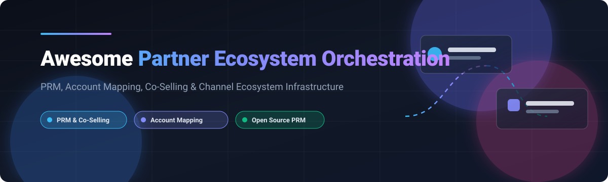

  

# 🤝 Awesome Partner Ecosystem Orchestration 🌐

  
  
  
  
  
  

---

## 📖 Overview & SEO Summary 🔍

> **A curated, comprehensive directory of Partner Ecosystem Orchestration (PEO) platforms, Partner Relationship Management (PRM) tools, Account Mapping solutions, Co-Selling engines, Channel Automation suites, and Open-Source affiliate/referral frameworks.**

Modern go-to-market (GTM) execution relies on **Ecosystem-Led Growth (ELG)**. Partner Ecosystem Orchestration bridges the gap between customer relationship management (CRM) systems and partner networks by automating partner recruitment, secure data/account mapping, lead sharing, deal registration, co-selling workflows, commission attribution, and partner portal self-service.

---

## 📑 Table of Contents 📌

- [📊 Market Dynamics & Industry Size](#-market-dynamics--industry-size)
- [🏢 SaaS & Hosted Platforms](#-saas--hosted-platforms)
- [💻 Open-Source Alternatives](#-open-source-alternatives)
- [⭐ Star History](#-star-history)
- [💖 Support & Sponsorship](#-support--sponsorship)
- [📜 License](#-license)

---

## 📊 Market Dynamics & Industry Size 📈

> **Market Analysis:** The global Partner Relationship Management (PRM) and Ecosystem Orchestration market is estimated at **$1.85 Billion in 2024–2026** (projected to reach **$4.2 Billion by 2030** at a **15.2% CAGR**), characterized by **moderate fragmentation transitioning toward an oligopolistic tier**—where enterprise hyperscalers (Salesforce, Impact.com) anchor end-to-end commerce and affiliate ecosystems, while specialized category leaders (Crossbeam, Reveal, WorkSpan, Impartner) compete fiercely to dominate the account mapping and co-selling subsegments.

---

## 🏢 SaaS & Hosted Platforms ☁️

The table below lists the premier proprietary Partner Ecosystem Orchestration, PRM, Account Mapping, and Co-Selling platforms, sorted by **Company Size (Revenue / Valuation) in descending order**.

| Rank | Platform | Category / Focus | Company Size (Revenue / Valuation) 🏛️ | Pricing (Starting Tier) 💵 | Free Tier / Trial Limits ⏳ | Key Capabilities 🛠️ |
|:---:|---|---|:---:|---|---|---|
| 1 | [Salesforce PRM (Experience Cloud)](https://www.salesforce.com/products/experience-cloud/partner-relationship-management/) | Enterprise PRM & Channel Hub | **$34.86B Revenue (FY24) / ~$280B Market Cap** | **$25/member/month** (Partner Community plan, billed annually) | **30-day free trial** (Full sandbox environment with sample partner data and community templates) | Complete partner lifecycle management, lead distribution, deal registration, and bi-directional Salesforce CRM integration. |
| 2 | [Impact.com](https://impact.com/) | Partnership Automation & Affiliate Cloud | **$250M+ ARR / $1.5B Valuation** | **$500/month** (Starter tier for emerging partnerships) | **No free forever plan; 14-day guided trial / sandbox on request** | Discovery, recruitment, tracking, fraud prevention, and cross-channel automated payouts for publishers, influencers, and B2B partners. |
| 3 | [Impartner PRM](https://impartner.com/) | Pure-play Enterprise PRM | **$80M+ ARR / ~$500M Valuation** | **$2,000/month** (Base platform tier) | **No free tier; 14-day proof-of-concept / sandbox trial upon sales qualification** | Turnkey partner portal, automated partner onboarding, pipeline management, co-branded collateral, and certified CRM connectors. |
| 4 | [Crossbeam](https://www.crossbeam.com/) | Account Mapping & ELG Data Cloud | **$30M+ ARR / ~$350M Valuation** | **$499/month** (Connector tier, billed annually) | **Free forever plan** (Up to 3 active partner sharing relationships, unlimited overlaps, 1 seat) | Secure data escrow account mapping, automated overlap detection, partner ecosystem attribution, and co-selling signals. |
| 5 | [PartnerStack](https://partnerstack.com/) | B2B SaaS Partner & Affiliate Platform | **$35M+ ARR / ~$300M Valuation** | **$999/month** (Startup plan) | **No free forever tier; 14-day sandbox trial available on sales demo request** | B2B SaaS partner recruitment marketplace, automated partner payouts, affiliate tracking, and deal registration. |
| 6 | [WorkSpan](https://www.workspan.com/) | Co-Sell Management & Hyperscaler Cloud | **$25M+ ARR / ~$200M Valuation** | **$1,500/month** (Starting tier for Co-Sell Orchestration) | **No free tier; 30-day piloted sandbox trial for approved partner teams** | Multi-party co-selling with Microsoft Azure, AWS, and Google Cloud, joint business planning, pipeline visibility, and funds management. |
| 7 | [Zift Solutions (ZiftONE)](https://ziftsolutions.com/) | Enterprise Channel as a Service (CCMS) | **$25M+ ARR / ~$150M Valuation** | **$1,200/month** (ZiftONE Core tier) | **No free forever tier; 14-day guided trial environment on request** | Comprehensive channel marketing automation, PRM, partner learning management (LMS), and lead distribution. |
| 8 | [Allbound](https://www.allbound.com/) | Next-Gen Partner Portal & PRM | **$15M+ ARR / ~$90M Valuation** | **$795/month** (Growth plan, up to 50 active partners) | **No free tier; 14-day sandbox trial available on scheduled evaluation** | Lightweight partner portal, real-time collaboration, deal registration, reward tracking, and native HubSpot/Salesforce sync. |
| 9 | [Reveal](https://reveal.co/) | Collaborative Account Mapping & Co-Selling | **$12M+ ARR / ~$80M Valuation** | **$399/month** (Pro plan) | **Free forever plan** (Up to 2 active partner connections, unlimited account mapping, 3 team seats) | Partner CRM signal sharing, pipeline attribution, account mapping, and joint go-to-market workflows. |
| 10 | [Pronto](https://www.gopronto.io/) | Ecosystem Management & Joint GTM | **$5M+ ARR / ~$35M Valuation** | **$500/month** (Team Starter tier) | **14-day full feature trial** (Includes up to 5 partner mappings and collaborative pipeline tracking) | Collaborative joint pipeline management, cross-partner governance, ecosystem analytics, and automated partner reporting. |

---

## 💻 Open-Source Alternatives 🚀

For engineering teams seeking self-hosted, sovereign, or customizable software for partner relationship management, affiliate networks, referral tracking, and deep attribution, here are the leading open-source repositories sorted by **GitHub Stars in descending order**:

| Repository | Stars ⭐ | Primary Role & Capabilities | Technology Stack 🧰 | License 📄 |
|---|:---:|---|---|:---:|
| [BranchMetrics / ios-branch-deep-linking-attribution](https://github.com/BranchMetrics/ios-branch-deep-linking-attribution) |  | Open-source mobile SDK powering partner deep-linking, cross-platform referral tracking, and multi-touch acquisition attribution. | Objective-C, Swift | Apache-2.0 |
| [Affitor / affiliate-skills](https://github.com/Affitor/affiliate-skills) |  | Collection of 50+ AI agent skills and automation frameworks for autonomous partner outreach, affiliate marketing, and campaign orchestration. | Python, Shell | MIT |
| [BranchMetrics / react-native-branch-deep-linking-attribution](https://github.com/BranchMetrics/react-native-branch-deep-linking-attribution) |  | React Native framework for programmatic referral engines, partner campaign sharing, and attribution analytics. | JavaScript, TypeScript | Apache-2.0 |
| [BranchMetrics / android-branch-deep-linking-attribution](https://github.com/BranchMetrics/android-branch-deep-linking-attribution) |  | Android SDK for partner referral systems, personalized app onboarding, and deep link campaign metrics. | Java, Kotlin | Apache-2.0 |
| [WeferralHq / weferral](https://github.com/WeferralHq/weferral) |  | Complete self-hosted affiliate and partner management platform with commission tracking, partner dashboards, and payout hooks. | TypeScript, React, Node.js | MIT |
| [amicalhq / refref](https://github.com/amicalhq/refref) |  | Open-source referral and affiliate marketing system built for fast deployment with modern web stacks. | TypeScript, Next.js, Tailwind | MIT |
| [BranchMetrics / cordova-ionic-phonegap-branch-deep-linking-attribution](https://github.com/BranchMetrics/cordova-ionic-phonegap-branch-deep-linking-attribution) |  | Hybrid cross-platform mobile SDK for referral campaigns, partner links, and deep funnel attribution. | JavaScript, Java, Obj-C | Apache-2.0 |
| [voocx / laravel-referral](https://github.com/voocx/laravel-referral) |  | Modular Laravel package for integrating partner referral links, custom attribution rules, and conversion tracking. | PHP, Laravel | MIT |
| [Refferq / Refferq](https://github.com/Refferq/Refferq) |  | Self-hosted referral & affiliate management application tailored for SaaS businesses and digital product creators. | PHP, JavaScript | AGPL-3.0 |
| [Affitor / open-affiliate](https://github.com/Affitor/open-affiliate) |  | Open machine-readable registry and programmatic directory of affiliate and B2B partner programs. | JSON, Markdown | MIT |
| [jijunair / laravel-referral](https://github.com/jijunair/laravel-referral) |  | Plug-and-play referral system package for Laravel applications with flexible tracking and reward logic. | PHP, Laravel | MIT |
| [intelliants / elitius](https://github.com/intelliants/elitius) |  | Open-source web-based affiliate tracking and partner portal software with customizable templates and commission rules. | PHP, MySQL | GPL-2.0 |

---

## 📈 Star History ⭐

---

## 💖 Support & Sponsorship 🙏

Thank you for visiting and supporting **Awesome Partner Ecosystem Orchestration**! 🌟

If you found this list useful, please consider:
- ⭐ **Starring** this repository to show your appreciation and help others discover it.
- 🍴 **Forking** the project and submitting pull requests with new tools, platforms, or open-source solutions.
- 📢 **Sharing** this repository with your network, partner managers, and developer community.
- ☕ **Buying a coffee & sponsoring ongoing maintenance** via the GitHub Sponsor Dashboard:
  
👉 [**Sponsor ishandutta2007 on GitHub Sponsors**](https://github.com/sponsors/ishandutta2007) 💖

---

## 📜 License 📄

Distributed under the MIT License. See [LICENSE](LICENSE) for more details.
